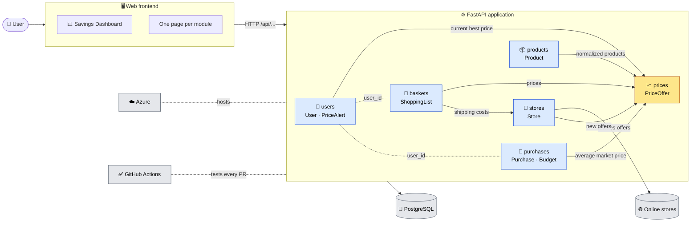

# 🔎 Shopping Detective

**Find where it's cheapest. Know when to buy. See what you saved.**

*Group 6 · Group Project*

[Theme](#-theme) · [Modules](#-modules) · [Cross-module features](#-cross-module-features) · [Architecture](#%EF%B8%8F-architecture-planned) · [Shared jobs](#-shared-jobs) · [Conventions](#-conventions-agreement) · [How we work](#-how-we-work)

---

## 💡 Theme

**Online price comparison for smart, budget-aware shopping.** Shopping Detective searches
several online stores for a product, shows where it is cheapest, tracks how prices move,
alerts users when a price drops, and tells them how much they saved against their
shopping budget.

### What a search returns

Search for a product, for example **"iPhone 17"**, and the app shows:

| | |
|---|---|
| 🏷️ **Product** | name and image |
| 🏬 **Stores** | every store that sells it, with its price and shipping cost |
| 💶 **Best deal** | the lowest total price (price + shipping) and a link to that store |
| 📈 **Timing** | the price history and whether now is a good time to buy |

Logged-in users can also set **price alerts**, build a **shopping list** and find the
cheapest way to buy it, record their **purchases** and follow their **savings** against a
monthly budget.

---

## 🧩 Modules

Each member owns one module end to end: its own main entity, Python package, API router
(`/api/<module>`), tests and page in the frontend.

| Module | Main entity (CRUD) | Calculated result | Page | Owner |
|---|---|---|---|---|
| 👤 **`users`** users and price alerts | `User`, `PriceAlert` (user, product, target price) | which alerts the current best price triggers, and how far each product is from its target | sign-up, login and my price alerts | Blas G. |
| 🏬 **`stores`** stores and price acquisition | `Store` (name, website, country, shipping cost, free-shipping threshold) | total cost per store (price + shipping) and each store's share of best prices | stores and their price competitiveness | Sara F. |
| 📦 **`products`** catalogue and normalization | `Product` (name, brand, EAN, category, image URL) | matching the same product across stores into one normalized product; search ranking | product search and catalogue | Jose Luis S. |
| 📈 **`prices`** price offers and history | `PriceOffer` (product, store, price, observed at, URL) | current lowest price, 30-day min / max / average and % change | product price comparison and history | Emile H. |
| 🛒 **`baskets`** shopping lists | `ShoppingList`, `ShoppingListItem` | cheapest basket: total in one store vs. split across stores, including shipping | my shopping lists and their cheapest basket | Susana P. |
| 🧾 **`purchases`** purchases and budget | `Purchase` (user, product, store, price paid, date) `Budget` (user, month, amount) | savings vs. average market price; budget spent and remaining this month | my purchases and monthly budget | Tomas M. |

> **User management.** `users` owns who uses the app: users sign up and log in, and each user
> sees and changes only their own data. Every module that holds personal data (alerts,
> shopping lists, purchases, budgets) links it to a `user_id`.

---

## 📊 Cross-module features

### 🔎 Best-deal search

The core of the app: one search combines `products` (the normalized product), `stores`
(each store and its shipping cost) and `prices` (each store's current price and the price
history) into a single result with the cheapest total price.

### 📊 Savings Dashboard

One page per user that brings the modules together:

| Dashboard block | Built from |
|---|---|
| 💰 Money saved this month, budget spent and remaining | `purchases` → asks `prices` for the average market price of each item bought |
| 🔔 Price alerts triggered today | `users` → asks `prices` for the current best price |
| 🛒 Cheapest way to buy my shopping list, and where | `baskets` → asks `prices` for prices and `stores` for shipping costs |
| 📈 Price trend of the products I follow | `prices` + `products` |

> Modules talk to each other **only through their API** (`/api/<module>`), never through
> each other's tables.

---

## 🏗️ Architecture (planned)

Solid arrows: one module calls another module's API. Dotted lines: data linked to a user, or shared infrastructure. `prices` (yellow) is the hub most modules depend on.

---

## 🤝 Shared jobs

On top of their module, each member is responsible for one part of the shared product.

| Shared job | Responsible for | Owner |
|---|---|---|
| ✅ Continuous integration | the GitHub Actions workflow: Ruff and the tests on every pull request | Tomas M. |
| 👀 Code review | the review rules, and that every pull request is reviewed | Susana P. |
| 🐳 Containers and configuration | the Dockerfile, Docker Compose, settings from environment variables, `.env.example` | Blas G. |
| ☁️ Cloud deployment | the Azure resources, the deployment and its cost | Jose Luis S. |
| 🖥️ Frontend shell and dashboard | the common layout, navigation and the Savings Dashboard | Emile H. |
| 🐘 Database | the shared database setup, the models' common base and the sample data | Sara F. |

> With six members we cover six of the seven shared jobs. Documentation and board is
> everyone's job: each member writes the documentation of their own module and keeps their
> own issues up to date on the board.

---

## 📐 Conventions agreement

| Topic | Agreement |
|---|---|
| **Stack** | Python 3.12, FastAPI, SQLAlchemy 2, PostgreSQL, pytest, Ruff, Docker Compose, Azure. The frontend pages are served by the same application. |
| **Layout** | one package per module under `app/<module>/` (`models.py`, `schemas.py`, `service.py`, `router.py`); tests in `tests/<module>/` |
| **Names** | packages and tables in lowercase plural English (`price_offers`); classes in singular CamelCase (`PriceOffer`) |
| **API** | every route under `/api/<module>`, JSON, plural nouns (`GET /api/prices/offers?product_id=12`); errors as `{"detail": "..."}` with the right status code |
| **Money** | `Decimal` in Python, `NUMERIC(12, 2)` in the database, **never a float**; every amount has a currency (`EUR` by default); amounts are strings in JSON (`"999.00"`) |
| **Dates** | timestamps in UTC as `timestamptz`, ISO 8601 in JSON (`2026-11-23T12:00:00Z`); calendar dates as `date` (`2026-11-23`) |
| **Users** | every personal record has a `user_id` that refers to `users` |
| **External data** | store data comes in through connectors in `stores`; tests and CI never call real stores, they use sample data and recorded responses |

---

## 🔀 How we work

We use **trunk-based development**: one long-lived branch (`main`) and short branches merged
within a few days, so modules are integrated continuously and conflicts stay small.

1. 🎫 **Every task is a GitHub issue**, assigned to one member, on the project board
   (*To do → In progress → In review → Done*).
2. 🌿 **One short-lived branch per issue**, named `<type>/<issue>-<short-name>`
   (`feat/12-price-history`, `docs/1-m1-readme`).
3. 🔄 **Bring `main` into your branch often** (`git pull origin main`).
4. 📬 **Small pull requests** that link their issue (`Closes #12`).
5. 👀 **Reviewed and approved by another member**, and the CI passes, before merging.
6. 🔒 **`main` is protected**: no direct pushes; merged with a **merge commit**.
7. 🏁 **Milestones are tagged** on the reviewed commit of `main` (`m1`, `m2`, …).

---

## ▶️ How to run it

> 🚧 Coming with the containers milestone: `cp .env.example .env`, then `docker compose up`.

---

## 👥 Team

| Member | Module | Shared job |
|---|---|---|
| Sara F. | 🏬 `stores` | 🐘 Database |
| Jose Luis S. | 📦 `products` | ☁️ Cloud deployment |
| Emile H. | 📈 `prices` | 🖥️ Frontend shell and dashboard |
| Blas G. | 👤 `users` | 🐳 Containers and configuration |
| Susana P. | 🛒 `baskets` | 👀 Code review |
| Tomas M. | 🧾 `purchases` | ✅ Continuous integration |
